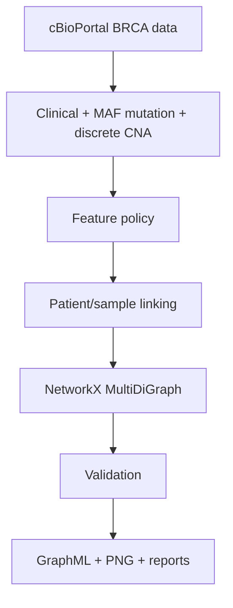

# Patient-specific BRCA graph construction

This repository implements milestone 1 of *Uncertainty-Aware Neuro-Symbolic Reasoning over Patient-Specific Healthcare Knowledge Graphs for Explainable Cancer Diagnosis*: cBioPortal BRCA TCGA PanCancer Atlas 2018 data to validated patient-specific NetworkX graphs. It does **not** implement PrimeKG integration, a graph database, GNNs, neuro-symbolic reasoning, uncertainty inference, or prediction.



## Data and selected evidence

The supplied `brca_tcga_pan_can_atlas_2018/` directory is read directly. The graph uses `data_clinical_patient.txt`, `data_clinical_sample.txt`, `data_mutations.txt`, and `data_cna.txt`. It retains compact clinical/tumor context, raw MAF evidence, and non-neutral discrete GISTIC gene CNA calls. Details and explicit exclusions are in [feature selection](docs/feature_selection.md); the complete streamed file audit is in [data audit](docs/data_audit.md).

The actual study contains no clinical `MUTATION_COUNT` or `FRACTION_GENOME_ALTERED` column. `mutation_record_count` is therefore a clearly labeled raw-MAF row count, while `ANEUPLOIDY_SCORE` is retained from the sample table. Outcomes are excluded from graph evidence to avoid target leakage.

## Schema and outputs

The graph is a `MultiDiGraph`: `Patient → Sample → Gene`, with parallel `has_mutation` and `has_CNA` edges when appropriate. MAF calls remain separate edges to preserve source records. See [graph schema](docs/graph_schema.md).

- `outputs/patient_graphs/*.graphml` — primary per-patient graphs
- `outputs/all_patient_graphs.graphml` — optional selected-patient view (when `--combined` is used; shared Gene nodes retain their HGNC/Entrez IDs)
- `outputs/visualizations/*.png` — compact, capped graph drawings
- `outputs/patient_summaries.csv` — selected-patient graph statistics
- `outputs/data_quality_report.{json,md}` — machine- and human-readable quality summary
- `outputs/dataset_audit.json` — complete raw schema/missingness audit

## Run

Install dependencies, then run from repository root:

```bash
pip install -r requirements.txt
python scripts/build_patient_graphs.py
```

The default builds eight deterministic representative patients. This is deliberate: the CNA matrix has more than 12 million non-neutral calls, so writing every patient to GraphML is materially large. To build one case or explicitly request all cases:

```bash
python scripts/build_patient_graphs.py --patient-id TCGA-3C-AAAU
python scripts/build_patient_graphs.py --all
python scripts/build_patient_graphs.py --sample-size 10 --combined
```

The default run performs a streamed audit of every requested raw table. Use `--skip-audit` only when regenerating graphs after an unchanged audit.

## Validation and limitations

`unittest` tests verify patient/sample mapping, mutation edge fidelity, CNA edge fidelity, graph shape, and raw-MAF count semantics. The runtime generator validates each written graph before export, retains missing CNA-column cases with a logged reason, and does not silently collapse mutation records.

This is a patient-fact layer, not yet a biomedical knowledge graph. Later PrimeKG work can attach the retained HGNC/Entrez gene identities to external entities without redesigning the Patient → Sample → Gene facts.
