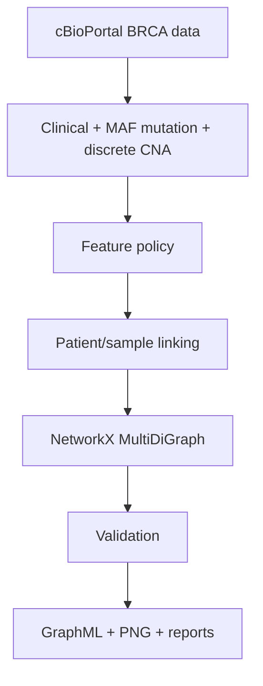

# Patient-specific BRCA graph construction

This repository builds patient-specific BRCA graphs from the cBioPortal TCGA PanCancer Atlas 2018 study and benchmarks recurrence models on those graphs fused with PrimeKG.

Milestone 1 writes validated NetworkX graphs (`Patient → Sample → Gene`) for the 500-gene panel. Milestone 2, documented in [recurrence modeling](docs/recurrence_gnn.md), adds a leakage-safe PFS label, a PrimeKG fusion, and a GCN / GATv2 / GraphSAGE / MLP comparison. It does not implement a graph database or uncertainty inference.



## Data and selected evidence

The supplied `brca_tcga_pan_can_atlas_2018/` directory is read directly. The graph uses `data_clinical_patient.txt`, `data_clinical_sample.txt`, `data_mutations.txt`, and `data_cna.txt`. It retains compact clinical/tumor context, raw MAF evidence, and non-neutral discrete GISTIC gene CNA calls. Details and explicit exclusions are in [feature selection](docs/feature_selection.md); the complete streamed file audit is in [data audit](docs/data_audit.md).

The actual study contains no clinical `MUTATION_COUNT` or `FRACTION_GENOME_ALTERED` column. `mutation_record_count` is therefore a clearly labeled raw-MAF row count, while `ANEUPLOIDY_SCORE` is retained from the sample table. Outcomes are excluded from graph evidence to avoid target leakage.

## Schema and outputs

The graph is a `MultiDiGraph`: `Patient → Sample → Gene`, with parallel `has_mutation` and `has_CNA` edges when appropriate. MAF calls remain separate edges to preserve source records. See [graph schema](docs/graph_schema.md).

- `outputs/patient_graphs/*.graphml` — primary per-patient graphs
- `outputs/all_patient_graphs.graphml` — optional selected-patient view (when `--combined` is used; shared Gene nodes retain their HGNC/Entrez IDs)
- `outputs/visualizations/*.png` — compact, capped graph drawings
- `outputs/patient_summaries.csv` — selected-patient graph statistics
- `outputs/data_quality_report.{json,md}` — machine- and human-readable quality summary
- `outputs/dataset_audit.json` — complete raw schema/missingness audit

## Run

Install dependencies, then run from repository root:

```bash
pip install -r requirements.txt
python scripts/build_patient_graphs.py
```

The default builds eight deterministic representative patients. This is deliberate: the CNA matrix has more than 12 million non-neutral calls, so writing every patient to GraphML is materially large. To build one case or explicitly request all cases:

```bash
python scripts/build_patient_graphs.py --patient-id TCGA-3C-AAAU
python scripts/build_patient_graphs.py --all
python scripts/build_patient_graphs.py --sample-size 10 --combined
```

The default run performs a streamed audit of every requested raw table. Use `--skip-audit` only when regenerating graphs after an unchanged audit.

## Recurrence benchmark

The supervised target is binary `PFS_STATUS` (`1:PROGRESSION` vs `0:CENSORED`). Outcome columns stay out of the patient graph. Each labeled patient is linked to a filtered PrimeKG neighborhood on Entrez id, then classified with stratified 5-fold cross-validation:

```bash
python scripts/train_and_evaluate_gnns.py
```

The mentor notebook is [notebooks/recurrence_gnn_milestone_demonstration.ipynb](notebooks/recurrence_gnn_milestone_demonstration.ipynb). It shows only the models that read the patient graph. On the fixed 2-hop graph **GCN** is the best of those three, at AUROC 0.680 ± 0.076 and AUPRC 0.396 ± 0.091; the plots and path tables are in `outputs/gnn_benchmark_36m/`.

The benchmark supports seven graph architectures — GCN, GraphSAGE, GATv2, R-GCN, RGAT, GIN, and a graph transformer — and can optimise the concordance index rather than only cross-entropy. The default benchmark is intentionally limited to GraphSAGE and R-GCN so patient-graph experiments finish quickly:

```bash
python scripts/train_and_evaluate_gnns.py --endpoint pfs_36m --loss cindex --rank-by cindex \
  --skip-sensitivity --output-dir outputs/gnn_benchmark_36m_cindex
python scripts/compare_benchmark_runs.py
```

`--loss cindex` trains on a differentiable C-index surrogate over comparable `(PFS_MONTHS, PFS_STATUS)`
pairs, and `--loss cox` trains on the Breslow partial likelihood. Follow-up time and event status are targets
only: they are never graph, clinical, or MLP features. Every fold reports AUROC, AUPRC, the C-index, F1, and
balanced accuracy alongside each other, and the results of those runs are in
[recurrence objectives and architectures](docs/recurrence_gnn.md#objectives).

The notebook then compares that fixed layout with graph structure learning, documented in [graph structure learning](docs/graph_structure_learning.md). `outputs/gnn_benchmark_gsl` is the first GSL run, whose free edge weights switched the hop-2 ring off. The GSL run with the hop prior wrote to `outputs/gnn_benchmark_gsl_prior`, which is not part of this repository, so that column is quoted from that run's own report and is marked as such in the notebook. Regenerate the comparison figure with:

```bash
python scripts/plot_gsl_hop_prior.py
```

The notebook closes with two figures. The first is one patient's graph fused with PrimeKG, drawn by `scripts/plot_fused_graph_example.py` from the walks the fixed 2-hop run stores for that patient. The second is the single highest-`path_score` walk in `outputs/gnn_benchmark_gsl/explanations.csv`, drawn by:

```bash
python scripts/plot_top_path.py
```

```bash
python scripts/train_and_evaluate_gnns.py --endpoint pfs_36m --skip-sensitivity --output-dir outputs/gnn_benchmark_36m
```

Install PyTorch from the CPU wheel index before `torch-geometric` if a CUDA wheel is not wanted:

```bash
pip install torch --index-url https://download.pytorch.org/whl/cpu
pip install -r requirements.txt
```

## Validation and limitations

`unittest` tests verify patient/sample mapping, mutation edge fidelity, CNA edge fidelity, graph shape, and raw-MAF count semantics. The runtime generator validates each written graph before export, retains missing CNA-column cases with a logged reason, and does not silently collapse mutation records.

This is a patient-fact layer, not yet a biomedical knowledge graph. Later PrimeKG work can attach the retained HGNC/Entrez gene identities to external entities without redesigning the Patient → Sample → Gene facts.
