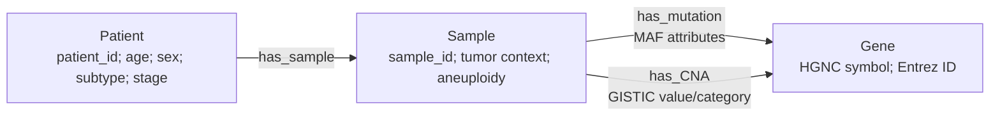

# Patient graph schema

Each output is a `networkx.MultiDiGraph`, selected because a sample may have multiple MAF records for the same gene and because mutation and CNA are distinct parallel relationships. It contains exactly one patient and all linked clinical samples for that patient.

## Nodes

| Type | Stable ID | Attributes |
| --- | --- | --- |
| Patient | `patient:{PATIENT_ID}` | `patient_id`, `age`, `sex`, `cancer_type_acronym`, `subtype`, `ajcc_pathologic_tumor_stage`, `path_m_stage` |
| Sample | `sample:{SAMPLE_ID}` | `sample_id`, `patient_id`, selected sample clinical fields, `mutation_record_count` |
| Gene | `gene:{Hugo_Symbol}:{Entrez_Gene_Id}` | `gene_symbol`, `entrez_gene_id`, `identifier_namespace=HGNC_symbol` |

The Entrez component avoids merging duplicate symbol rows found in the CNA matrix. A gene node is local to a patient graph; no external knowledge graph is copied into it.

## Edges

| Type | Direction | Attributes |
| --- | --- | --- |
| `has_sample` | Patient → Sample | `source_file=data_clinical_sample.txt` |
| `has_mutation` | Sample → Gene | source MAF row identity; classification/type/consequence; protein/cDNA change; coordinates/alleles; impact/filter/callers; `source_file`, `source_study` |
| `has_CNA` | Sample → Gene | non-neutral `cna_value`, `cna_category`, source provenance |

Graphs have `source_dataset`, `source_study`, `graph_generation_version`, `graph_scope`, and `patient_id` graph-level metadata. Clinical values remain attributes rather than artificial numeric fact nodes: an age or mutation-count node would not represent a biomedical entity. This Patient → Sample → Gene layout is intentionally suitable for later gene-to-PrimeKG alignment without changing patient facts.
